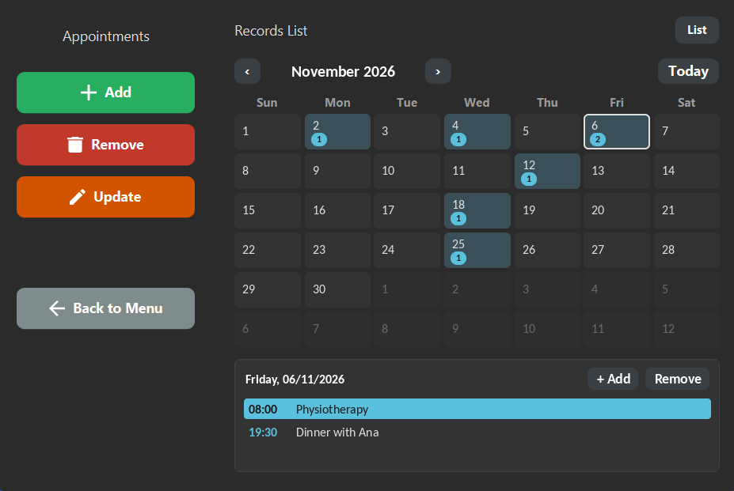
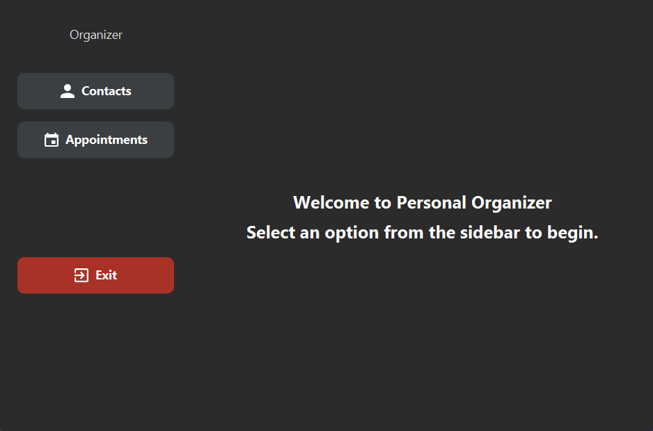
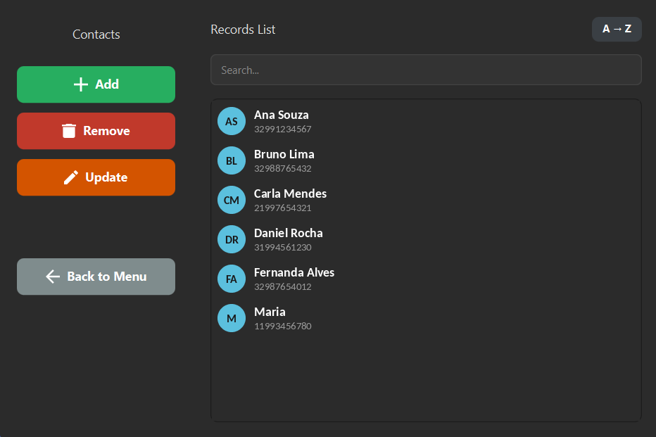
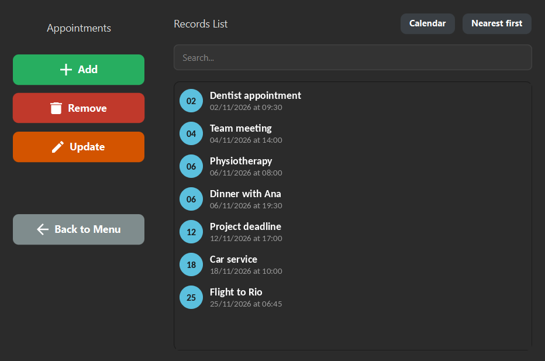
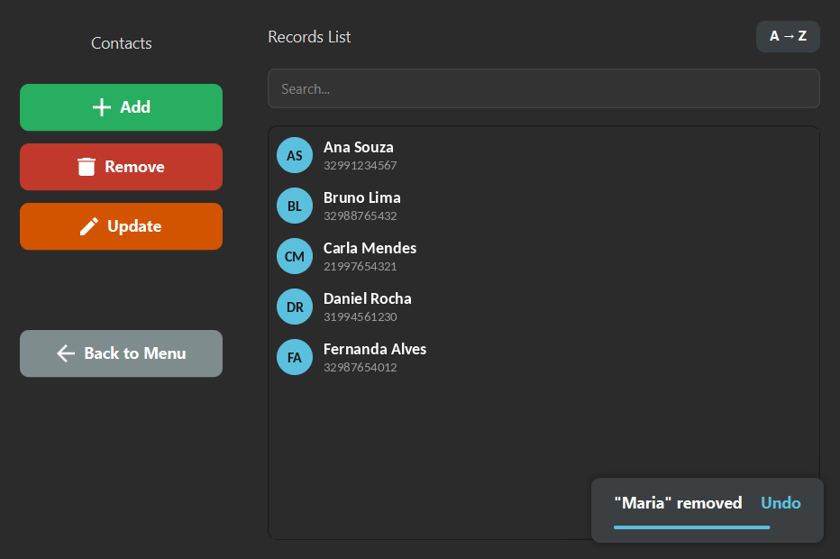

# Personal Organizer

A desktop agenda to manage contacts and appointments, built with Java and JavaFX.
Data is stored locally in CSV files, so there is no database or account to set up.



## Features

- **Contacts and appointments** with add, update and remove
- **Live search** across names, phones, dates and times
- **Sorting:** contacts A→Z / Z→A, appointments by date
- **Monthly calendar** for appointments: click a day for details,
  double-click it or use "+ Add" to create, "Remove" to delete
- **Undo** for removals, with a countdown toast
- **Flexible input:** dates like `3/10/26` and times like `8:30` are normalized automatically
- **Automatic cleanup** of past appointments
- Responsive dark interface with icons and a friendly empty state

## Screenshots

| Home | Contacts |
|---|---|
|  |  |

| Appointments | Undo on removal |
|---|---|
|  |  |

## Download and run

Requires **Java 17 or later**. Pick the jar for your system on the
[Releases](https://github.com/toledoemanuel/Organizer---Java/releases) page:

| System | File |
|---|---|
| Windows | `personal-organizer-1.1.1-win.jar` |
| Linux | `personal-organizer-1.1.1-linux.jar` |
| macOS (Intel) | `personal-organizer-1.1.1-mac.jar` |
| macOS (Apple Silicon: M1 or newer) | `personal-organizer-1.1.1-mac-aarch64.jar` |

Then run it (replace `win` with your system):

```bash
java -jar personal-organizer-1.1.1-win.jar
```

Your data is saved as CSV files in the folder where you run the jar.

## Build from source

Requires JDK 17+ and Maven.

```bash
git clone https://github.com/toledoemanuel/Organizer---Java.git
cd Organizer---Java
mvn clean package
java -jar target/personal-organizer-1.1.1-win.jar
```

The default build targets Windows. For another system, pick a profile:
`-Plinux`, `-Pmac` or `-Pmac-aarch64`. The jar is generated as
`target/personal-organizer-1.1.1-<system>.jar`.

To run directly from Maven during development:

```bash
mvn javafx:run
```
```

## Project structure

```
src/main/java/com/emanuel/
├── controllers/   # MainController, ManagementController
├── exceptions/    # DuplicateItemException, InvalidItemException, ItemNotFoundException
├── utils/         # DialogUtils, ToastUtils, CalendarView, RecordCell, SearchFilter, SortUtils
├── Organizer.java # Generic container of Schedulable items
├── Schedulable.java, Contact.java, Appointment.java
└── CSVManager.java
src/main/resources/com/emanuel/   # FXML views and style.css
```

## Built with

Java 17 · JavaFX 17 · Maven

## License

This project is licensed under the MIT License. See the [LICENSE](LICENSE) file for details.
